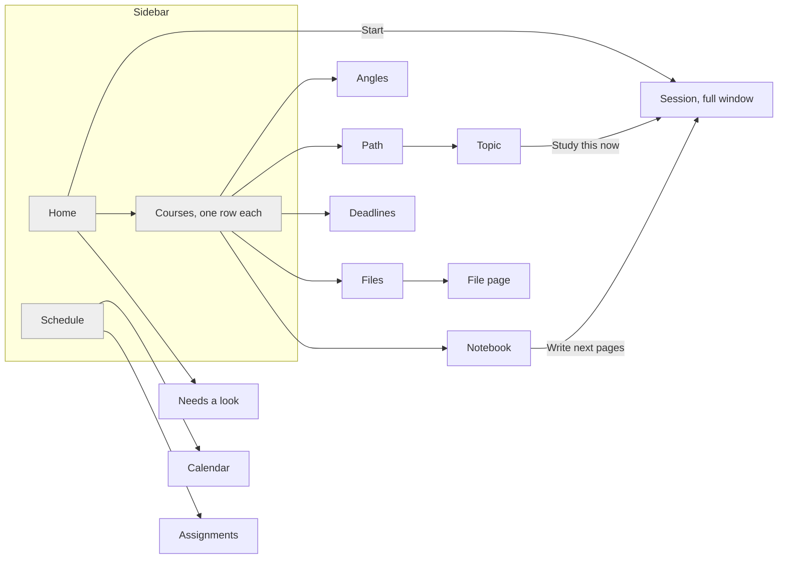

# Study Tracker: UI Screen Document

Reference for UI work. It describes what the SwiftUI app (`Sources/StudyTracker/`) shows today, screen by screen, and how screens link. Where this disagrees with [SPEC.md](SPEC.md), **this document reflects the code**; [decisions.md](decisions.md) D18 explains the redesign behind it.

Platform: macOS 15+, one window (default 1240×820, minimum 980×640), a Settings window and a menu bar extra. Local-first, one user, works without AI.

---

## 1. Map

### Structure

- **Sidebar:** Home (badge: the number of things that need a look), one row per course (archived ones collapsed), Schedule. Settings and a dot for a connection that needs attention sit at the bottom.
- **Toolbar:** back and forward, the breadcrumb, a quiet AI status line (what's running; failed work in the attention colour; opens Settings › AI) and Settings.
- **Sessions take the whole window**, like setup. Closing one (✕ or Esc) saves the step it's on.
- **Every screen has a route** (`studytracker://…`, table in §5); old routes from earlier versions open their new homes.

### Keyboard

| Keys | Action |
| --- | --- |
| `⌘↩` | Start the next session |
| `⌘1`, `⌘2`, `⌘3`… | Home, Schedule, then the first seven courses |
| `⌘K` | Command palette |
| `⌘N`, `⌘O` | New assignment (quick add), import files |
| `⌘⇧R` | Just review |
| `⌘⇧S`, `⌘⇧P`, `⌘⇧L` | Sync, plan study blocks, new AI chat |
| `⌘[` `⌘]`, `⌘Z` `⌘⇧Z` | Back and forward, undo and redo |
| In a session | `⌘T` tutor, `Esc` close, `Space` and `1`–`4` on cards, `↩` the step's main action |

## 2. Design constraints

Unchanged from `Theme.swift` and SPEC §7.1: semantic colour tokens only, one attention colour reserved for real urgency (overdue, due within 48 h, topics behind class, failed work), course colours only as dots and thin bars, a five-step type scale, and every theme passing its contrast test. Lessons and notebook pages render through LessonKit (marked and KaTeX in a sandboxed web view) with the theme passed in as CSS variables, so they follow light, dark and every theme.

## 3. Screens

### 3.1 Home (`home`)

- A greeting with the date.
- **Next session** card: what it is ("Revenue Management · 2.3 Overbooking"), why it's next ("Final exam in 9 days · taught Tue · 25 min"), **Start**, then *Quick 10 min*, *Deep 50 min* and *Just review*. With nothing to do: "You're up to date."
- **Then:** up to two more suggestions, one from another course when it's nearly as urgent.
- Plan notes in secondary colour: a tight exam (only for assessments worth 10% or more), topics behind class.
- **Urgent work** banner (overdue or at-risk graded work) with *Open*.
- **Courses:** dot, name, one note (building, topics behind class, the next exam, or no path yet), notebook pages written and topics solid.
- **This week:** deadlines with weekday and weight.
- "N things need a look →" when there are any.

### 3.2 Course (`course/{id}/{tab}`)

Header: course dot, name, code, instructor, *Edit*. Five tabs:

| Tab | Shows |
| --- | --- |
| **Path** | Who built it ("Built by the course builder · Claude Code", "Basic version, built with free AI", "Outline from your lectures") and what the builder is doing now; *Build with Claude* (or *Copy for Claude.ai* / *Open in Claude Desktop* without Claude Code); the course's next session with *Start*; how to learn it; units with numbered topics, each with its summary and tags (exam-critical, taught on a day, notebook page, mastery). Context menu: *Study this now*, *I know this*, *Hide*, *Bring back*. |
| **Notebook** | "The whole course: N pages · about X to write", pages written, *Write next pages*, *Index* (number, topic, page, to copy into the notebook), *Print or PDF…*. Then the whole guide on one page, drawn natively: unit dividers and a dotted page per topic with Words (and the course's wording with its slide), Pictures (reference drawing: a graph or process drawn by the app, or a simple SVG; what to draw and label) and Formulas (typeset), plus *Mark written* / *Change* (asks for the page number). |
| **Angles** | How the course grades (from the course builder), where past exams give marks (bars per topic), the kinds of questions they ask, and the topics the course stresses. |
| **Files** | Files grouped by use (shapes your path, practice, exams, course info, not used), each with its use chip and the reason it was sorted that way. |
| **Deadlines** | Grade card, open and done deadlines, class times. |

### 3.3 Topic (`topic/{id}`)

Number and title, mastery and tags, summary and objectives, *Study this now*, *Write its page* (when it isn't written), *More* (I know this, Hide). Then the notebook page (native) and the lesson (LessonKit), where the course teaches it (files with slide locators) and its practice problems.

### 3.4 Session (full window)

Top bar: ✕ (saves), title and course, the steps with the current one highlighted, *Tutor* (`⌘T`, only with an engine that can tutor), elapsed time.

| Kind | Steps |
| --- | --- |
| Notebook | One-time tips, then per page: the page guide, *page in your notebook* (optional), *Written · next page* or *Not now* |
| Topic | Warm-up (due cards from the course) → Learn (the notebook page, the pre-question, the lesson; without a lesson, the course's slides while one is written at top priority) → Practice (the course's problems first: answer box, hint, *Check my answer* as advice, *Show solution*, then *Missed / Partly / Got it*) → Explain (2–3 sentences, *Get feedback*, then *Not yet / Mostly / Nailed it*) → Lock in (the lesson's cards, ticked, editable, *Add a card*) |
| Review | Due cards |
| Exam prep | Recall (per topic: cover the page, recall and redraw, *Show the page*, *Shaky / Solid*) → Practice (exam-style, shaky topics first) → Lock in |

Quick sessions skip explaining it back and hold fewer cards, pages and problems; deep ones hold more. The end shows each topic's mastery before → after, cards kept or recalled, and *Start next*.

### 3.5 Schedule (`calendar/…`, `assignments`)

The calendar (week, month, agenda; drag to move a class, then *this class only*, *following* or *all*; *Plan study*) and assignments (quick add, list and board, each assignment's page). Importing a timetable `.ics` previews what it changes first.

### 3.6 Needs a look (`needs-a-look`)

One row per decision, each with a default: a file with no course (choose one, *File it*, *Remove*), a file the sorting wasn't sure about (use chip, *Looks right*), a deadline found in a syllabus, Moodle or a calendar (*Add*, *Dismiss*), a conflict with your edits (*Keep mine*, *Take the new one*), old proposed flashcards (*Keep them*, *Let them go*), an expired Moodle sign-in, and AI work that failed (*Try again*, *Dismiss*). The Home badge counts exactly these rows.

### 3.7 File page (`file/{id}`)

The file's use chip, taught date and sort reason; problems split out of it (with solutions); what a syllabus says (deadlines, outcomes, weekly plan); the outline; earlier-version data collapsed.

### 3.8 Settings (`⌘,`, `settings/{pane}`)

General, Study, Terms and breaks, **AI** (Everyday AI and Course builder on top, everything else under Advanced, with the AI history), **Connections** (Moodle, Calendars, Apple Calendar), Notifications, Appearance, Data and export, Advanced.

### 3.9 Setup (`setup/{welcome|school|ai|done}`)

Welcome (*Get started*, *Try sample data*) → Your school (Moodle, or add courses by name) → AI (the two AI rows; *Use Claude Code to build your courses*) → Done (each course and its files; *Go to Home* prepares every course's path).

## 4. Overlays and global surfaces

- **Command palette (`⌘K`):** *Start* the next session, Home, Calendar, Assignments, Needs a look, Just review, Settings panes, actions, and per course: the course, *Write notebook*, *Rebuild with Claude*, and every topic; open assignments and files.
- **Menu bar:** next session with *Start*, the next class, due soon, *Open*, *Review N*.
- **Chat sheet:** the tutor (knows the topic and step; reads the topic, its slides and pictures; saves nothing) and draft checks.
- **Paste sheet (Copy for any chatbot / Copy for Claude.ai):** the prompt in parts, links to chatbots, a box for the answer, *Import* through the same checks as every other route.
- **Toasts:** results with *Undo* or a link to where the result lives.

## 5. Routes

| Route | Screen |
| --- | --- |
| `home` | Home |
| `needs-a-look` | Needs a look |
| `course/{id}/{path\|notebook\|angles\|files\|deadlines}` | Course tab |
| `topic/{id}` | Topic |
| `file/{id}` | File page |
| `calendar/{week\|month\|agenda}[/{date}]`, `calendar/occurrence/{key}` | Calendar |
| `assignments`, `assignment/{id}` | Assignments |
| `settings/{pane}` | Settings window |
| `setup/{step}` | Setup |

Older links still open: `today`, `study/…` and `review/…` → Home; `inbox/…` → Needs a look; `material/{id}` → File page; `connections/ai` and `activity/…` → Settings › AI; other `connections/…` → Settings › Connections; old course tabs → Path, Files or Deadlines; old setup steps → the step that replaced them.

## 6. File map

| Directory | Screens |
| --- | --- |
| `App/` | `StudyTrackerApp` (scenes, commands, root view, sidebar, AI status line), `AppModel` (routes, sessions, imports), `DebugSnapshots` (`-snapshotRoutes home,course/*/notebook,session/topic@practice,…`) |
| `Home/` | `HomeView` (with the next-session card and reasons), `NeedsLookScreen` |
| `Course/` | `PathTab`, `NotebookTab`, `AnglesTab`, `FilesTab` |
| `Topic/` | `TopicPage` |
| `Session/` | `SessionController`, `SessionView` (every step) |
| `Components/` | `Theme`, `NotebookPageView` (notebook pages, formulas, drawings), `DiagramView`, `LessonKit` (lessons, printing), `CardReviewer`, `AssignmentLine` |
| `Settings/` | `AISettingsSimple`, `AIHistory`, `ConnectionsSettings` |
| `Schedule/` | `ICSPreviewSheet` |
| `Views/` | Calendar, Assignments, Courses (course page, Deadlines tab, editor), File page, Settings, Setup, Moodle settings, chat and paste sheets, palette and menu bar |
